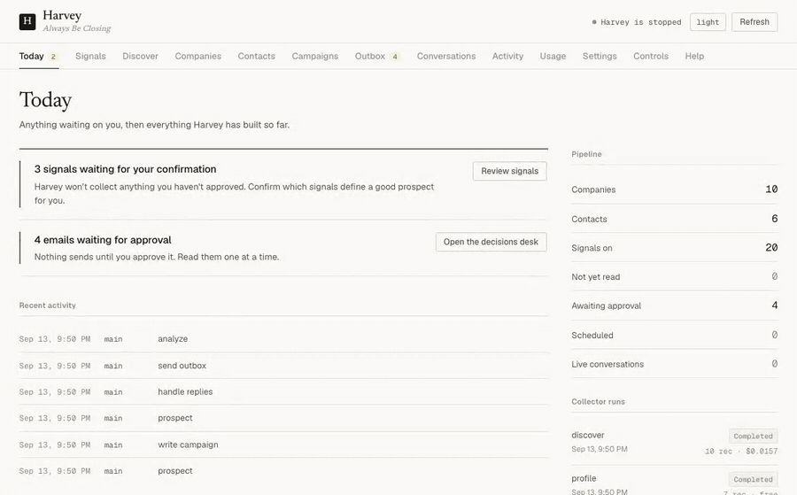

# harvey but for antigravity

**An autonomous sales agent built for Google Antigravity (`agy`).**

Harvey finds businesses worth selling to, learns something specific about each one, writes cold email that references it, sends it, reads the replies, and works the conversation toward a meeting. It runs on your machine, in a loop, on its own.

The unusual part: **there is no model API bill.** Harvey uses your Google Antigravity (`agy`) / Gemini quota. Model calls run directly through your existing Antigravity environment, without an API key or per-token API billing.

```
$ harvey run

============================================================
Harvey is online. Always Be Closing.
============================================================
Checking pipeline state...
Decision: prospect (only 3 new prospects; pipeline needs leads)
  discover  → 41 businesses in Portland, OR       ($0.00, OpenStreetMap)
  profile   → 41 sites read, 288 observations     (free, no model calls)
  scout     → 12 scored against your ICP
Decision: write_campaign (12 new prospects with no drafts)
  writer    → 3-email sequence for Cascade Landscaping
  outbox    → 12 emails waiting for your approval
Cycle complete. Sleeping for 15 minutes.
```

And the dashboard it keeps, at `localhost:5555` — confirming a signal, building a
cohort out of the confirmed ones, pricing a discovery run before it spends
anything, and approving mail one message at a time:



---

## Table of contents

- [Why the subscription thing matters](#why-the-subscription-thing-matters)
- [Antigravity native integration](#antigravity-native-integration)
- [What Harvey actually does](#what-harvey-actually-does)
- [Quick start](#quick-start)
- [Interactive slash commands](#interactive-slash-commands)
- [Antigravity custom subagents](#antigravity-custom-subagents)
- [You confirm what it looks for](#you-confirm-what-it-looks-for)
- [The prospecting pipeline](#the-prospecting-pipeline)
- [The skills library](#the-skills-library)
- [The sub-agents](#the-sub-agents)
- [Nothing sends without you](#nothing-sends-without-you)
- [The dashboard](#the-dashboard)
- [How the data is stored](#how-the-data-is-stored)
- [Configuration](#configuration)
- [Using Google Antigravity (`agy`)](#using-google-antigravity-agy)
- [Legal and deliverability](#legal-and-deliverability)
- [Troubleshooting](#troubleshooting)
- [Project structure](#project-structure)
- [Philosophy](#philosophy)
- [Roadmap](#roadmap)

---

## Why the subscription thing matters

Every other autonomous sales agent bills you per token. That is the whole reason they cost what they cost: an agent that thinks in a loop, all day, is an agent that burns API credits in a loop, all day. Vendors solve this by thinking less — shorter prompts, cheaper models, fewer passes.

Harvey invokes Google Antigravity's `agy` CLI in headless mode (`agy -p`), leveraging Gemini models and your existing Antigravity quota without per-token charges.

Antigravity runs with external tools disabled so Harvey handles web discovery, HTTP profiling, SQLite updates, and email operations natively in Python.

**What this costs you:**

| | |
|---|---|
| Google Antigravity (`agy`) / Gemini | your existing Antigravity environment & quota |
| Finding businesses | **$0** on the default source, or ~$0.37 per 1,000 on the cheapest paid one |
| Reading their websites | **$0** — three HTTP requests each, no model call |
| Writing and sending | your Antigravity environment + a mailbox (~$7/mo Google Workspace) |
| Prospecting tools | **none.** No Apollo, no ZoomInfo, no Clearbit, no Clay. |

For comparison, the tools Harvey replaces start at $250–500/month — and they are weakest precisely where Harvey is strongest: small local businesses with 5–50 people, where single-provider contact coverage caps out around 30% and micro-businesses are frequently absent entirely.

**Harvey also budgets itself.** It checks Antigravity's quota and throttles to leave headroom for your interactive coding work. Set `max_daily_provider_percent: 80` in `harvey.yaml`. If quota cannot be read directly from the CLI, Harvey safely falls back to its daily call budget.

---

## Antigravity native integration

Harvey is purpose-built to operate inside Google Antigravity:

- **`.agents/rules/harvey-safety.md`** enforces non-negotiable invariants: never send to addresses tagged `guess` or `invalid`, never bypass outbox approval by default, and always run within the project virtual environment.
- **`.agents/skills/`** provides full Antigravity skill architecture for email copywriting frameworks, signal hooks, and workflow automations.
- **`.agents/subagents/`** defines parallel autonomous subagents (`harvey-scout`, `harvey-writer`, `harvey-closer`) with `subagent: true` frontmatter that appear in Antigravity's `/agents` panel.
- **`GEMINI.md`** equips the Antigravity agent with comprehensive architectural context, interactive setup instructions, and live operational commands.

---

## What Harvey actually does

Harvey runs a heartbeat: wake up, check the budget, decide what most needs doing, do it, log it, sleep. Every 15 minutes by default.

```
                 ┌──────────────────────────────────────┐
                 ↓                                      │
   Wake  →  Quiet hours?  →  Budget OK?  →  Decide  →  Act  →  Log  →  Sleep
                 │               │
              (sleep)         (sleep)
```

It decides deterministically, not by asking a model what to do — that would burn a call on something derivable from four counts:

```
handle replies  >  send campaigns  >  write campaigns  >  prospect  >  idle (analyze)
```

Profiling and outbox draining ride along on **every** cycle regardless, because they cost nothing and have to happen on schedule.

---

## Quick start

### Prerequisites

- **Python 3.11+** — verify with `python --version` or `python3 --version`.
- An active **Google Antigravity (`agy`)** environment with Gemini.
- A mailbox to send from — Gmail/Google Workspace recommended on a *dedicated secondary domain*. Microsoft 365 and SMTP/IMAP work too.

### Easiest: let Antigravity set it up

Clone and open the project in Google Antigravity:

```bash
git clone https://github.com/ethanplusai/harvey.git
cd harvey
```

Then simply ask the Antigravity agent in chat:
> **"Set up Harvey for me"** (or run `/harvey-setup`)

The agent checks your environment, installs dependencies, verifies `.env` keys, trains Harvey on your product URL, and confirms free signals.

### Or do it yourself via CLI

```bash
# 1. Install inside virtualenv (Windows PowerShell)
python -m venv .venv
.venv\Scripts\Activate.ps1
pip install -e .
python -m playwright install chromium

# On Linux / macOS:
# python3 -m venv .venv && source .venv/bin/activate && pip install -e .

# 2. Configure credentials
cp .env.example .env && $EDITOR .env

# 3. Learn your product from your website
harvey train https://your-company.com

# 4. Confirm free prospecting signals (costs $0)
harvey signals --confirm free

# 5. Find businesses (free OpenStreetMap source)
harvey discover

# 6. Watch it work
harvey dashboard          # http://localhost:5555
harvey run
```

---

## Interactive slash commands

Harvey provides three native Antigravity workflow skills in `.agents/skills/`:

| Command | Skill | Action |
|---|---|---|
| **`/harvey-setup`** | [`harvey-setup`](.agents/skills/harvey-setup/SKILL.md) | Guides `.venv` health checks, `.env` API keys, automated website training (`harvey train <url>`), and signal confirmation (`harvey signals --confirm free`). |
| **`/harvey-discover`** | [`harvey-discover`](.agents/skills/harvey-discover/SKILL.md) | Displays discovery provider menu with pricing, runs projected spend estimation (`harvey discover --estimate`), prompts for confirmation, and triggers `harvey profile`. |
| **`/harvey-outbox`** | [`harvey-outbox`](.agents/skills/harvey-outbox/SKILL.md) | Queries pending drafts from `data/harvey.db`, displays them with matched prospect signals, and allows you to approve, edit copy, or reject directly in the chat. |

---

## Antigravity custom subagents

Harvey includes reusable custom subagents in `.agents/subagents/` that mirror and parallelize Harvey's internal workers:

- **`harvey-scout.md` (`harvey-scout`)**: *ICP & Signal Scorer*. Queries un-scored prospects from `data/harvey.db`, cross-references observations, scores them 1–100, generates 1-2 sentence personalization hooks, and records scores to SQLite.
- **`harvey-writer.md` (`harvey-writer`)**: *Cold Outreach Sequence Writer*. Pulls verified prospects, loads email frameworks and signal playbooks, drafts personalized 3-email sequences referencing exact signals (e.g. `INCUMBENT_AGENCY`, `RUNNING_GOOGLE_ADS`), enforces zero-AI-tell rules, and stages drafts to the outbox.
- **`harvey-closer.md` (`harvey-closer`)**: *Inbox & Objection Handler*. Triages prospect replies, classifies intent, applies LAARC (Listen, Acknowledge, Assess, Respond, Confirm) to objections, and drafts consultative meeting proposals while strictly enforcing opt-out compliance.

---

## You confirm what it looks for

Harvey knows how to collect **23 signals** about a business. It does not collect any of them until you say so. On first run it *proposes* the catalog; you confirm, skip, or reject each one in the dashboard or from the terminal:

```bash
harvey signals                       # review the catalog
harvey signals --confirm free        # everything that costs nothing (21 of them)
harvey signals --confirm SERP_RANK   # a paid one, opted into explicitly
```

Every signal shows what it is in plain language, **what it costs**, and how many companies already carry it.

| | Signal | What it tells you |
|---|---|---|
| **Discovery** | `SERP_RANK` | Where they rank for their own core search. Positions 11–30 are the sweet spot: visible enough to be trying, and losing. |
| | `NO_WEBSITE` | They have a listing and a phone and no site. If you sell websites, the highest-intent signal that exists. |
| | `UNCLAIMED_LISTING` | Nobody has claimed their Google Business Profile. |
| | `REVIEW_RATING` / `REVIEW_COUNT` | Good but invisible, or visible but struggling. |
| **Profile** | `INCUMBENT_AGENCY` | Who currently has the account, credited in their own footer (confidence: 0.90 strong, 0.75 descriptive, <0.35 ignored). |
| | `RUNNING_GOOGLE_ADS` / `RUNNING_META_ADS` | They are spending on acquisition *today*. The strongest budget signal available for free. |
| | `NO_ONLINE_BOOKING` | Leads have to phone in, so after-hours demand is lost. |
| | `NO_SCHEMA_MARKUP` | A concrete, checkable SEO gap you can name in an email. |
| | `BLOG_STALE` | Content marketing started and abandoned. |
| | `SITE_PAGE_COUNT`, `TECH_STACK`, `BLOCKS_AI_CRAWLERS`, `HIRING_ROLE` | Size, platform, AI-search visibility, and what they're hiring for. |
| **People** | `CONTACT_FOUND`, `DECISION_MAKER_TITLE`, `LIKELY_OWNER`, `REGISTRY_VERIFIED` | Who decides, and whether they own the place. |
| **Contact** | `EMAIL_PATTERN`, `EMAIL_STATUS`, `CONTACT_FORM_URL` | Whether you can actually reach them. |

### Then a cohort is a query, not a list

Once signals are confirmed, the dashboard's cohort builder turns them into a target set — pick what a good prospect **must have** and what **disqualifies** them, and it counts the matches live:

```
Has a marketing agency  AND  running Google Ads  AND NOT  already has online booking
→ 23 companies
```

---

## The prospecting pipeline

Four stages. Each one runs independently, re-runs safely, and states its cost.

### 1. DISCOVER — who exists

The only stage that spends money, so it always estimates first and never calls anything until you press go.

```bash
harvey discover --providers   # the menu, with real prices
harvey discover --estimate    # projected spend, then exits
harvey discover               # go
```

| Source | Cost | Free tier | Best for |
|---|---|---|---|
| **OpenStreetMap** *(default)* | free | unlimited, no account | Trying the whole pipeline before paying anyone. |
| **DataForSEO Business Listings** | $0.372 / 1,000 | $1 credit | Local trades, clinics, contractors, businesses without websites. |
| **DataForSEO SERP** | $0.0018 / search | $1 credit + free sandbox | Rank as the buying signal (sweet spot: pos 11–30). |
| **Serper** | ~$0.30–1.00 / 1,000 | 2,500 free, no card | Reliable paid search discovery. |

### 2. PROFILE — what they are

**Free.** Three HTTP requests per business. No browser, no model call. This produces the facts that make an email specific.

Homepage, `robots.txt`, `sitemap.xml`, plus team and careers pages — then regex over HTML already in hand. Out comes the incumbent agency, ad pixels, missing schema, abandoned blog, open roles, and named humans.

Agency detection scores the footer wording:
- `"Powered by"` / `"Website by"` → **0.90** confidence
- Bare descriptive link (e.g. "web design agency") → **0.75** confidence
- Bare unlabelled links → **0.35** and **strictly ignored**

### 3. ENRICH — who decides

Free public registries first. Name plus title from the team page, confirmed against an authoritative registry where one exists.

### 4. VERIFY — can you reach them

Harvey learns each company's **address pattern** and verifies one candidate via generous free-tier integrations (Reoon: 600/mo, ZeroBounce: 100/mo, Hunter: 50/mo).

Every address is tagged honestly: `verified` / `risky` (catch-all) / `guess` / `invalid`. **Only deliverable ones are ever sent to.**

---

## The skills library

Harvey's sales knowledge lives in `.agents/skills/` (and `skills/`) as **plain Markdown you can edit**. Harvey's Python brain loads from `.agents/skills/<skill-name>/SKILL.md` (stripping YAML frontmatter) with fallback to `skills/`.

### What ships

- **`email_frameworks.md`** — 300+ lines of cold email copywriting rules, 2026 reply-rate benchmarks, banned AI tells, compliance rules, and five frameworks: **AIDA, PAS, BAB, QVC, 3Ps**.
- **`signal_playbook.md`** — How to turn buying signals into personalized email hooks, signal prioritization, and footer agency confidence thresholds.
- **`objection_handling.md`** — The **LAARC** loop (Listen → Acknowledge → Assess → Respond → Confirm) across budget, authority, need, and timing objections with strict opt-out guardrails.
- **`lead_qualification.md`** — **BANT** screening, ICP scoring 1–10, **MEDDIC**, and disqualification criteria.
- **`sales_methodology.md`** — ABC loop, multi-channel orchestration, COSTAR tone calibration, and ethical rules.
- **`offer_strategy.md`** — Offer ladder by engagement level and closing mechanics.
- **`prospecting_tactics.md`** — Google dorking queries, site scraping, and email pattern discovery.
- **`account_navigation.md`** — Account mapping and multi-threading without collisions.
- **`linkedin_outreach.md`** — Connection sequences, warm-ups, and ToS safety limits.
- **Auto-generated for your product (`harvey train <url>`)**:
  - `skills/product_knowledge.md`
  - `skills/competitive_intel.md`

---

## The sub-agents

| Agent | What it does |
|---|---|
| **Scout** | Scores and personalizes discovered contacts. Python does the scraping; the model only provides judgment. |
| **Writer** | Generates 3-email sequences. Email 1 under 75 words, Email 2 under 75, Email 3 under 40. Hard ban list on AI-sounding language. |
| **Sender** | Renders merge variables per prospect and stages emails into the outbox. Drains with jitter, enforcing daily caps and stop-on-reply. |
| **Handler** | Polls for replies, dedups, classifies intent, advances conversation stages, handles bounces, and trips kill switch on high bounce rates. |
| **Analyst** | Computes pipeline statistics and campaign performance on idle cycles. |

---

## Nothing sends without you

By default **every outgoing email waits for your approval.** Harvey operates as a copilot until you decide otherwise.

Review and approve mail:
- In the dashboard at `http://localhost:5555` (**Outbox** tab).
- In Antigravity chat using `/harvey-outbox`.
- From the terminal:

```bash
harvey outbox                 # review queue
harvey outbox --approve <id>  # approve single email
harvey outbox --approve-all   # approve all
harvey sending pause          # emergency kill switch
```

Before sending, a **deterministic pre-send gate** rejects unrendered merge tags, banned spam phrases, emails over the length cap, multiple links, HTML bodies, and non-deliverable addresses.

Set `channels.email.require_approval: false` in `harvey.yaml` when ready for full autopilot.

---

## The dashboard

```bash
harvey dashboard     # http://localhost:5555
```

Fast, lightweight local web UI served via FastAPI with pure HTML/CSS/JS (no Node build step required):
- **Today**: Priority queue of decisions waiting on you, followed by recent activity.
- **Signals**: Proposed signal catalog confirmation and cohort builder.
- **Discover**: Provider menu with pricing and live estimate runner.
- **Companies / Contacts**: Directory of accounts with CSV export.
- **Outbox**: Single-email decisions desk with keyboard navigation (`A` approve, `R` reject, `J`/`K` navigate).
- **Conversations**: Full message threads with intent classifications.
- **Usage**: Provider quota gauges and token ledgers.

---

## How the data is stored

SQLite at `data/harvey.db`:
> **Every fact is a row, never a column.**

Stored in the `observations` table:
```sql
observations(company_id, prospect_id, collector, signal_code,
             value_num, value_text, confidence, evidence_url, observed_at, run_id)
```
- A new signal needs no schema migration.
- History is preserved as a natural time series.
- Confidence and evidence URLs travel with the fact.
- Cohorts are evaluated cleanly in SQL.

---

## Configuration

**`.env`** — credentials (email provider, verification keys, optional discovery APIs).

**`harvey.yaml`** (or gitignored `harvey.local.yaml`):

```yaml
persona:      { name, company, role, email, tone }
product:      { name, description, pricing, key_benefits, objection_responses, offer }
icp:          { industries, titles, company_size, geography, hiring_signals, geo_coordinates }
channels:
  email:      { provider: gmail | microsoft | smtp | instantly, max_daily_sends, require_approval,
                send_to_risky, max_bounce_rate }
usage:        { max_daily_provider_percent, heartbeat_interval_minutes, quiet_hours }
brain:
  provider: antigravity     # Google Antigravity ('agy')
  model: gemini-2.5-pro     # optional: gemini-2.5-pro | gemini-2.5-flash
```

---

## Using Google Antigravity (`agy`)

Harvey integrates directly with Google Antigravity (`agy`):

```yaml
brain:
  provider: antigravity
  model: gemini-2.5-pro     # or leave blank for default
```

1. **Headless Execution**: Calls `agy -p` with zero external tools enabled, enforcing tool-isolation while letting Gemini power the reasoning.
2. **Quota Awareness**: Respects `max_daily_provider_percent` against Antigravity quota limits, automatically falling back to daily call accounting if quota gauges are inaccessible.
3. **Slash Commands & Agents**: Use `/harvey-setup`, `/harvey-discover`, and `/harvey-outbox`, plus subagents `harvey-scout`, `harvey-writer`, and `harvey-closer`.
4. **Readiness Check**: Verify provider status with:
   ```bash
   harvey status --check
   ```

---

## Legal and deliverability

Harvey automates outreach, but **you are the sender.**
- **CAN-SPAM (US)**: Truthful subject lines, real identity, valid physical address in footer, immediate opt-out honoring.
- **GDPR / PECR (EU & UK)**: Legitimate interest basis, verifiable relevance to role, effortless objections.
- **Per-recipient checks**: Optional [Precleared](https://precleared.dev) integration (`compliance.precleared.enabled: true`).
- **Bot disclosure**: Harvey answers truthfully if asked whether it is an AI or automated system.
- **Deliverability**: Dedicated secondary domain, SPF/DKIM/DMARC configured, 2–4 weeks warmup, ramp gradually (<50 sends/day).

---

## Troubleshooting

- **`command not found: harvey`**: Activate virtual environment (`.venv\Scripts\Activate.ps1` on Windows, or `source .venv/bin/activate` on Linux/macOS).
- **`Brain provider error` / `antigravity failed`**: Confirm `agy` is installed and logged in. Test with `agy -p "say hi"`. Run `harvey status --check`.
- **Emails stuck in Outbox**: Harvey operates in copilot mode by default (`require_approval: true`). Review and approve in `/harvey-outbox` or the web dashboard.
- **Discovery finds nothing**: Run `harvey signals --confirm free` first. Nothing is collected until signals are confirmed.
- **Bounces or sending paused**: Harvey auto-trips a kill switch if bounce rate exceeds `max_bounce_rate`. Check list verification and resume with `harvey sending resume`.

---

## Project structure

```
harvey/
├── main.py              # heartbeat loop
├── brain.py             # Provider orchestration & Antigravity bridge
├── antigravity.py       # Google Antigravity (agy) headless CLI provider
├── state.py             # SQLite schema, observations, cohorts, outbox
├── signals.py           # 23-signal catalog
├── pipeline.py          # DISCOVER → PROFILE chaining
├── gate.py              # Deterministic pre-send gate
├── dashboard.py         # FastAPI web UI & API
├── collectors/          # discover (OSM, DataForSEO, Serper) & profile (HTTP profiler)
├── agents/              # scout, writer, sender, handler, analyst
├── integrations/        # mail providers (Gmail, M365, SMTP), email finder, quota
└── web/                 # Pure HTML/CSS/JS dashboard

.agents/
├── rules/               # harvey-safety.md (safety invariants)
├── skills/              # email-frameworks, signal-playbook, workflows (/harvey-*)
└── subagents/           # harvey-scout, harvey-writer, harvey-closer

skills/                  # Markdown sales knowledge files (synced with .agents/skills)
prompts/                 # Agent system prompts
tests/                   # 402 passing unit tests
```

---

## License

MIT

---

*"Put that coffee down. Coffee is for closers."* — Blake, *Glengarry Glen Ross*
